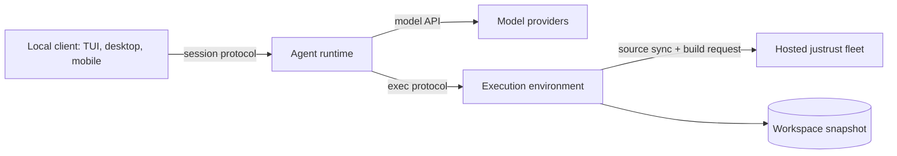

# Serverless Jcode

Status: exploration with a working prototype of the execution seam, November
2026. Nothing here is deployed. Each claim below is marked as measured,
or as a proposal that still needs proof.

## Goal

Replace "one persistent VM per user" (`docs/JCODE_CLOUD_AWS.md`) with three
parts that scale independently:

| Part | Holds | Does not hold |
| --- | --- | --- |
| Client | UI, device credential | conversation state, workspace |
| Agent runtime | model loop, session, hooks, policy, telemetry, todo, swarm, memory, MCP, web tools | the workspace, a shell |
| Execution environment | the checkout, a shell, background tasks | model credentials, the conversation |
| Hosted justrust | Rust toolchain, target directories, dependency cache | anything else |

The persistent VM does all four jobs at once and is sized for the heaviest
(Rust compiles: the tier table goes up to 8 vCPU and 32 GiB). Once compiles go
to the build fleet, the execution environment only edits, greps and runs light
commands, so it can be small, start on demand and stop when idle.

## What exists today

- `jcode serve` is one process that runs the model loop and executes every
  tool in its own OS environment. Cloud moves that whole process to a VM.
- `jcode cloud ephemeral` creates short-lived machines with a TTL, but each is
  still a full Jcode server reached over SSH.
- Tools dispatch through `Registry::execute` in
  `crates/jcode-app-core/src/tool/mod.rs`, which wraps the call with hooks,
  policy, telemetry and the context guard. That single call site is the seam.

## The execution seam (prototype, measured)

`crates/jcode-app-core/src/tool/remote_exec.rs`.

- The runtime reads `JCODE_EXEC_WORKER`, a shell command whose stdin and
  stdout carry newline-delimited JSON. `JCODE_EXEC_WORKDIR` names the
  workspace path inside the environment.
- `jcode server exec-worker` is the other end. It builds a tool registry with
  a provider that refuses every model call, and serves `call` and `cancel`
  frames, answering with `result` frames. Calls run concurrently.
- Routed tools: `bash`, `read`, `write`, `edit`, `apply_patch`, `agentgrep`,
  `bg`. Everything else stays in the runtime. `batch` and `codemode` subcalls
  are routed one by one because they go back through the registry.
- Dropping the runtime's future (user interrupt) sends `cancel`, which aborts
  the task in the worker. A dead worker fails its pending calls and the next
  call starts a new one.

Because the transport is just a command, the same runtime reaches a local
process, `docker exec -i`, `ssh host`, or a relay to a serverless sandbox
without code changes.

### Measured on 2026-11-13

1. Unit test `worker_runs_workspace_tools_and_refuses_runtime_tools`: the
   worker writes a file and runs a shell command in its directory, and refuses
   `todo`.
2. End to end: `jcode run` on the host with
   `JCODE_EXEC_WORKER='docker exec -i <box> jcode server exec-worker'` and an
   `ubuntu:24.04` container holding only the source and the jcode binary. The
   model's `bash` call returned the container's hostname, and its `write` call
   created `marker.txt` in the container's workspace and not in the host
   checkout. Model credentials never entered the container.

### Prototype limits

- One worker per runtime process. Production needs one per session (or per
  workspace) with its own lifecycle.
- No interactive stdin forwarding (`stdin_request_tx` is not carried).
- Tool output arrives whole, not streamed. Long `bash` calls show nothing
  until they finish.
- Tools that read files in the runtime process see the runtime's disk, not
  the workspace: image attachments, `open`, `side_panel` file reads, LSP,
  selfdev. Each needs routing or an explicit "not available" answer.
- The system prompt still describes the runtime's machine (OS, cwd, git
  status). It must describe the execution environment.
- Background task files live in the environment, so `bg` is routed, but
  completion wakeups to the runtime are not forwarded yet.
- The worker binary is the full 346 MB selfdev `jcode`. A real image wants a
  small worker-only binary.

## Rust compiles from a source-only sandbox

The claim that makes a small sandbox viable is that it never compiles. Tested
in the same toolchain-free container with the static `justrust` client and the
account's `jcode-subscription.env` mounted read-only:

- Sign-in works: `justrust remote use hosted` reported the account and plan.
- `justrust remote test` failed: `cargo metadata: No such file or directory`.
  The client shells out to local cargo to learn which directories to mirror.
- Fix written in `~/justrust` (`src/remote_build.rs`): when cargo is absent,
  fall back to the manifest walk the build daemon already uses. It has a unit
  test. **Not yet verified**: the justrust checkout did not compile at the time
  because of another agent's unfinished edits in other files, so neither the
  test nor a real hosted build from the container has run.
- The client also needs `ssh`, `rsync`, `curl`, `git` and `tar` in the image.
- Known gap in the fallback: a path dependency outside the repository that
  only a workspace member names is not mirrored.

Other languages have no build fleet. Node, Python and Go work run in the
sandbox itself, so sandbox size is still a per-project setting.

## Where the execution environment runs

The account backend already runs on Cloudflare, so Cloudflare Containers and
the Sandbox SDK are the first candidate. From their documentation, not yet
tried here:

| Property | Cloudflare Containers / Sandbox | Effect |
| --- | --- | --- |
| Start | on demand from a Durable Object, sleeps when idle | fits per-session lifetime |
| Size cap | custom types up to 4 vCPU, 12 GiB, 20 GB disk | enough for edit and grep, not for large builds |
| Disk | fresh after sleep | workspace must be restored: snapshot or re-clone |
| Exec | `exec()` with stdout, stderr, exit code | carries the worker's stdio |

Alternatives: the existing ephemeral machines API (already built, full VMs,
slow to start, no per-request billing), Fly Machines, Modal, or a Firecracker
pool on the build fleet. The seam does not care, which is the point: pick by
cost and start time after measuring.

The agent runtime is a long-lived Rust process holding a streaming model
connection, a session and MCP children. It does not fit a Worker isolate. It
needs a container or small VM per active session (or a shared pool), with
session state written to durable storage so it can stop between turns.

## Open problems, in order

1. **Workspace persistence.** With ephemeral disk, every wake needs the
   checkout back, including uncommitted changes and untracked files. Options:
   platform snapshots, an object-store tarball per session, or a git ref the
   sandbox pushes to on idle. This decides cold-start time more than anything
   else.
2. **Runtime placement and state.** Sessions are files under `~/.jcode` and
   in-memory state in one server. A stoppable runtime needs them in a store.
3. **Credentials.** The sandbox needs git and build credentials but no model
   keys. `docs/cloud-environment.md` already defines a typed, allowlisted
   fetch protocol that fits.
4. **Latency.** Every tool call gains a network round trip. Unmeasured.
   `docker exec` locally says nothing about a real relay.
5. **Cost.** No numbers yet. The comparison is VM-hours per user against
   sandbox-seconds plus runtime-seconds plus builds.

## Next steps

1. Land and verify the justrust no-cargo fallback, then run a real hosted
   `justrust test` from the toolchain-free container.
2. Stream tool output and forward background-task wakeups over the protocol.
3. Per-session workers and an environment-aware system prompt.
4. Deploy the worker in one Cloudflare sandbox behind a relay, and measure
   cold start, per-call latency and workspace restore time.
5. Decide workspace persistence from those measurements.
